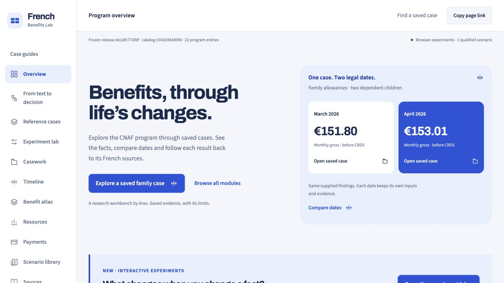
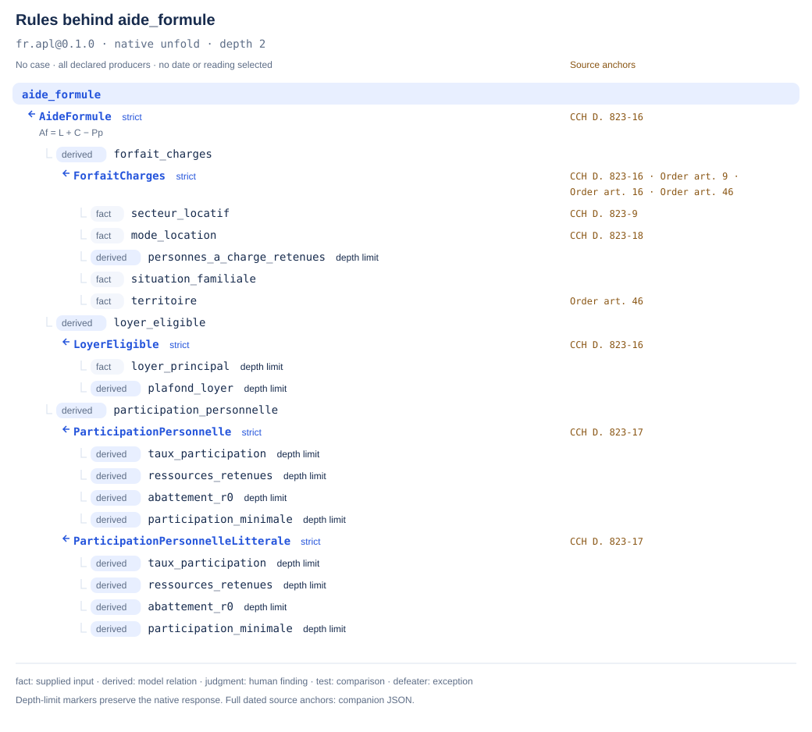
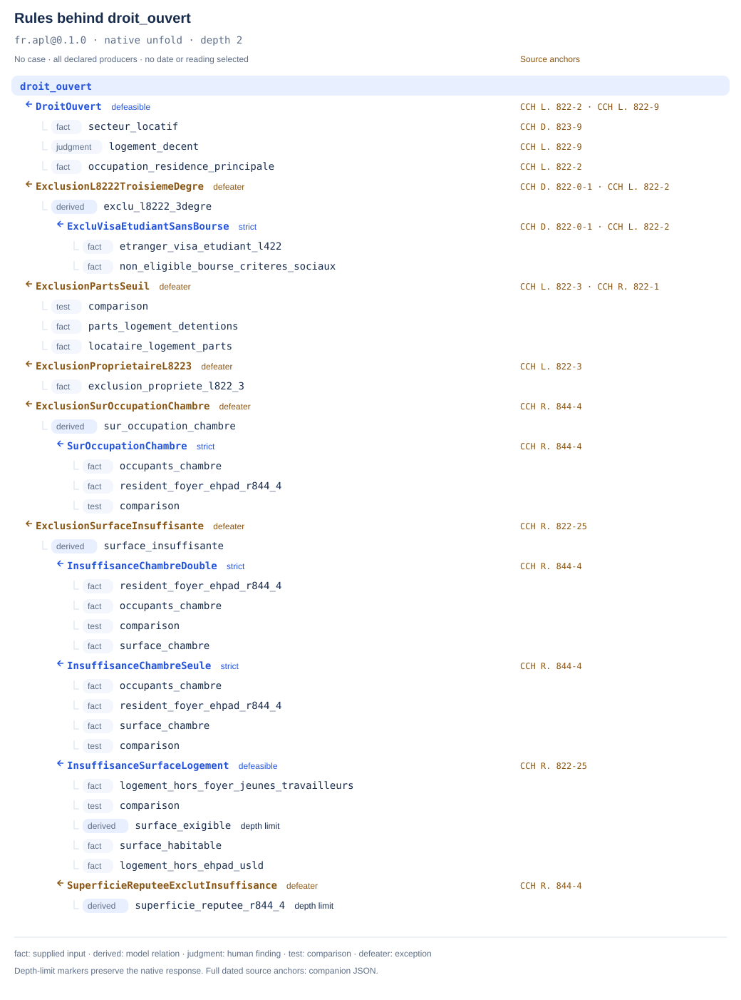

[](https://books.arxo.io/law-as-code-france/)

# arxo-cnaf

Explore French benefit rules as executable models, and trace their answers
back to published legal sources.

**[Explore the demo](https://french-benefits.law.arxo.io/)** ·
**[Run an example](#quick-start)** ·
**[Read the book](https://books.arxo.io/)**

> **First of all, a demonstration.** This repository shows what modelling legislation with Arxo can do:
> French family-benefit law written as executable canons, with the source of every answer. It is an
> independent model built from published French law for teaching and demonstration. It does not claim
> legal accuracy or completeness, it is not an implementation by or for the Cnaf or any French
> authority, and its answers are not legal advice. For a real file, rely on the official texts and the
> competent bodies.

## Choose your starting point

| I want to… | Start here |
|---|---|
| Explore saved cases and their sources in a browser | [French Benefits Lab](https://french-benefits.law.arxo.io/) — no installation |
| Use a model from JavaScript or TypeScript | [Node.js package](#use-from-nodejs) |
| Run a scenario on my machine | [Quick start](#quick-start) |
| Find the model for a benefit | [Browse the models](#browse-the-models) |
| Reproduce a chapter of the book | [Book examples](https://github.com/arxohq/law-as-code-france-examples#readme) |
| Rebuild a package or check the registry | [Reproducibility guide](docs/reproducibility.md) |

[](https://french-benefits.law.arxo.io/)

*French Benefits Lab, captured on 12 October 2026. Open the demo and choose
“Explore a saved family case” to inspect its inputs, answer and French sources.
The lab presents its own recorded evidence release; its coverage and version
are separate from this repository's export.*

## What it answers

| Question | Explore a concrete example |
|---|---|
| How does a selected reading change the amount? | [One APL case, two readings](#example-one-case-two-readings) |
| Why is an answer withheld? | [The same APL case without a selected reading](packages/fr.apl/tests/finish-lecture-pp.lawtest#L175) |
| Where do an amount and its parameters come from? | [Follow an instruction to a saved calculation](https://french-benefits.law.arxo.io/from-text-to-decision/) |
| What changes between two legal dates? | [Compare saved dates in the lab](https://french-benefits.law.arxo.io/benefit-timeline/) |
| Which facts, duties and stages does a case involve? | [Browse the book's fictional case files](https://github.com/arxohq/law-as-code-france-examples#chapters-and-folders) |

The browser examples belong to the lab's recorded release. The local APL
example below belongs to this repository's pinned model.

## Use from Node.js

Node.js **20+**. The pinned models are available as
[`@arxo/canon-fr-benefits`](https://www.npmjs.com/package/@arxo/canon-fr-benefits).
Load one world and ask it through the common `@arxo/law` API:

```sh
npm install @arxo/law@0.4.2 @arxo/canon-fr-benefits@0.1.0
```

```js
import { open } from '@arxo/law';
import { loadModel } from '@arxo/canon-fr-benefits/apl';
import { household, caseInput } from '@arxo/canon-fr-benefits/examples/apl';

const model = await loadModel();
const apl = await open(model.spec, {
  offline: true,
  local: { packages: { [model.spec]: model.package } },
});
const answer = await apl.collect('aide_formule', [household, '?amount'], caseInput);
console.log(answer.evaluationStatus); // COMPUTED
console.log(answer.value[0].value);   // '20.17' (EUR, formula amount)
console.log(apl.unfold('aide_formule', { depth: 2 }).text);
```

The input is the technical APL case below, with `PpPlancherFinal` selected.
The answer includes the engine's canonical document, proof and hashes.
This is a formula amount, not a final payable benefit. The package contains
all 21 models; loading a subpath parses only the selected world.

[Package API, model exports, TypeScript and verification limits](npm/README.md).
Source models are pinned to the original public export; npm delivery checks
are separate from full corpus acceptance, which remains **not checked**.

## Quick start

You need **Git, Node.js 20+ and npm**. This example uses the released
**`law` 0.2.2** command-line tool, which executes the models. The package
already includes its pinned dependency; no Python, source restoration or
registry installation is needed for this scenario.

```sh
npm install -g @arxo/cli@0.2.2
law --version

git clone https://github.com/arxohq/arxo-cnaf.git
cd arxo-cnaf/packages/fr.apl

law test . --file tests/finish-lecture-pp.lawtest --json
```

This runs seven scenarios about the personal contribution in housing aid
(article D. 823-17). Success means the command exits with code `0` and the
JSON report records no failed scenarios. These are checks against the
model's declared expectations, not certification of legal accuracy.
The successful report includes these fields:

```json
{"ok": true, "passed": 7, "failed": 0, "notRun": 0, "total": 7}
```

**What to explore next:** [compare the readings](#example-one-case-two-readings),
then open the [scenario file](packages/fr.apl/tests/finish-lecture-pp.lawtest).

Need help getting started? See [Troubleshooting](docs/reproducibility.md#troubleshooting).

## Example: one case, two readings

The model records two readings of the personal contribution in article
D. 823-17. The choice enters at `SensMinimumPp`, an interpretation group
that requires exactly one of `PpPlancherFinal` or `PpLitteral`.

The [scenario](packages/fr.apl/tests/finish-lecture-pp.lawtest) fixes a single
person with no dependants, zone II in metropolitan France, legal date
**15 June 2024**, supplied resources of **€4,000** and **zero rent**.
It also supplies ordinary housing, sole tenancy, zero solidarity rent
reduction and no AAH/AEEH beneficiary. Zero rent deliberately isolates the
reading difference; this is a technical probe, not a realistic aid claim.

The pinned parameters used in this probe are `P0 = €37.91`, `Tp = 0.0283`,
`R0 = €5,186`, `L = €0` and `C = €58.08`.

| Selected reading | Personal contribution `Pp` | Formula amount `Af` |
|---|---:|---:|
| `PpPlancherFinal` — keep a final floor at `P0` | €37.91 | €20.17 |
| `PpLitteral` — apply the formula without that final floor | €4.3462 | €53.7338 |
| No reading selected | `INTERPRETATION_REQUIRED` | `INTERPRETATION_REQUIRED` |

Both readings feed the same `participation_personnelle` relation. The same
`AideFormule` rule then uses `Af = L + C − Pp`. These are exact formula
amounts in the probe; neither is presented as the final payable benefit.
The model leaves the choice explicit rather than selecting a reading for you.

### The rules behind the amount

This is the native `unfold` response for `aide_formule`, rendered as a tree
from the published `fr.apl@0.1.0` world. Each rule exposes its premises,
strength and source anchors. The two contribution producers are both
visible: `ParticipationPersonnelle` and `ParticipationPersonnelleLitterale`.



*No case, legal date or reading is selected. This shows the model's available
rules, not which rules applied to a particular answer. The depth-limit
markers come from the engine. Repeated article locators are grouped visually;
the JSON retains every dated source anchor.*

[Full native JSON](docs/unfold/aide-formule.json) ·
[Native text and labels](docs/unfold/aide-formule.txt) ·
[Reproduce these trees](docs/reproducibility.md#reproduce-the-rule-trees)

Follow the map in the actual model:

| Step | Inspect |
|---|---|
| Source references and captured publications | [`01-sources.law`](packages/fr.apl/01-sources.law) — `CCH_D823_17`, `CCH_D823_16` and their dated versions |
| Selection and literal branch | [`24-lecture-pp.law`](packages/fr.apl/24-lecture-pp.law) — `SensMinimumPp`, `ParticipationPersonnelleLitterale` |
| Final-floor branch and downstream formula | [`02-calcul-locatif.law`](packages/fr.apl/02-calcul-locatif.law) — `ParticipationPersonnelle`, `AideFormule` |
| Both readings and the missing-selection check | [`finish-lecture-pp.lawtest`](packages/fr.apl/tests/finish-lecture-pp.lawtest) — the seven scenarios run in the Quick start |

## Rules and exceptions

The same view for `droit_ouvert` shows a defeasible opening rule alongside
its exception rules (`defeater`). Expanding `surface_insuffisante` exposes
its own producers and an exception to that condition. `fact`, `derived`,
`judgment` and `test` are distinct kinds of premise in the native response.



*This is a map of declared rule structure across the published world, not
an eligibility finding for a person. No case, date or reading is selected.*

[Full native JSON](docs/unfold/droit-ouvert.json) ·
[Native text and labels](docs/unfold/droit-ouvert.txt) ·
[Declared exception scenarios](packages/fr.apl/tests/finish-droit-defeaters.lawtest)

## How to read a model

**Published text → executable rules → dated case facts → answer and evidence.**

A **canon** is a package containing a legal model, its source references and
checks. A **scenario** supplies facts, dates and any selected interpretation,
then states the expected answer. A **pinned source** is a captured publication
identified by its provenance and a content hash, so the model's input can be
checked later.

The rules are data in `.law` files, executed by `law`. This repository carries
no separate implementation of the benefit formulas in application code.
Models have individual scope and date boundaries; read a package's source
and scenarios before applying its answers to a different case.

## At a glance

| This snapshot | Recorded value and evidence |
|---|---|
| Subject | French benefit models, including housing, family, disability, care and income support; each package has its own scope |
| Canon export | 12 October 2026 · [public source revision `f2efcc6`](https://github.com/arxohq/arxo-cnaf/tree/f2efcc6788465484f145146a3ed5f76b13d41703) |
| Source packages and scenarios | 21 packages · 1,985 declared scenarios · [`packages.json`](packages.json) |
| Model semantics | `law.core/0.2.11` · [`fr.apl/law.lock`](packages/fr.apl/law.lock) |
| CLI for the Quick start | Released `law` 0.2.2; expected report: 7 passed, 0 failed |
| Registry publications | 22 packages including the dependency closure · [reproducibility guide](docs/reproducibility.md) |

## Browse the models

The names below identify the subject of each model, not a claim of complete
coverage of that benefit. The [version and scenario inventory](docs/reproducibility.md#package-inventory)
records the exported package versions and dependency counts.

### Housing

| Subject | Model |
|---|---|
| Housing aid (APL / AL) | [`fr.apl`](packages/fr.apl/) |
| Housing-aid payment stage | [`fr.apl.versement`](packages/fr.apl.versement/) |
| Income used for housing aid | [`fr.tax.income_for_apl`](packages/fr.tax.income_for_apl/) |

### Family and children

| Subject | Model |
|---|---|
| Family allowances (AF) | [`fr.pf.af`](packages/fr.pf.af/) |
| Early-childhood benefits (PAJE) | [`fr.pf.paje`](packages/fr.pf.paje/) |
| Childcare supplement (CMG) | [`fr.pf.cmg`](packages/fr.pf.cmg/) |
| Family supplement (CF) | [`fr.pf.cf`](packages/fr.pf.cf/) |
| School-start allowance (ARS) | [`fr.pf.ars`](packages/fr.pf.ars/) |
| Family support allowance (ASF) | [`fr.pf.asf`](packages/fr.pf.asf/) |

### Disability and care

| Subject | Model |
|---|---|
| Adult disability allowance (AAH) | [`fr.css.aah`](packages/fr.css.aah/) |
| Disabled-child education allowance (AEEH) | [`fr.pf.aeeh`](packages/fr.pf.aeeh/) |
| Parental presence allowance (AJPP) | [`fr.pf.ajpp`](packages/fr.pf.ajpp/) |
| Caregiver allowance (AJPA) | [`fr.css.ajpa`](packages/fr.css.ajpa/) |

### Income support

| Subject | Model |
|---|---|
| Active solidarity income (RSA) | [`fr.casf.rsa`](packages/fr.casf.rsa/) |
| Activity bonus | [`fr.css.prime_activite`](packages/fr.css.prime_activite/) |
| Resources for minimum-income benefits | [`fr.minima.ressources`](packages/fr.minima.ressources/) |

### Shared rules and parameters

| Subject | Model |
|---|---|
| Family-benefit foundations | [`fr.pf.core`](packages/fr.pf.core/) |
| Benefit payments and debt recovery | [`fr.prestations.versement`](packages/fr.prestations.versement/) |
| Revaluation | [`fr.css.revalorisation`](packages/fr.css.revalorisation/) |
| Social-security ceiling (PASS) | [`fr.css.pass`](packages/fr.css.pass/) |
| Minimum wage (SMIC) | [`fr.travail.smic`](packages/fr.travail.smic/) |

## Find your way around the repository

| Path | What it contains |
|---|---|
| [`packages/`](packages/) | Model sources, captured texts, scenarios and pinned dependencies, one directory per canon |
| [`registry/`](registry/) | Installable publications and their dependency closure — 22 packages, including dependencies; not a duplicate of the source tree |
| [`tools/`](tools/) | Scripts to obtain the pinned build tools and restore withheld sources |
| [`packages.json`](packages.json) | Exported package versions, hashes, dependency lists and recorded scenario outcomes |
| [`toolchain.lock.json`](toolchain.lock.json) | Exact build-tool release and its SHA-256 |
| [`WITHHELD.json`](WITHHELD.json) | Addresses and hashes of source files that are not redistributed |

For a case package that consumes these canons, follow
[Install the book examples](docs/reproducibility.md#install-the-book-examples).
For compilation, scenario checks, replay and release rebuilds, follow
[Rebuild a source package](docs/reproducibility.md#rebuild-a-source-package).

## Release and verification

Published with *Law as Code in Practice: French Family Benefits*
(Law as Code by Country · Volume 1), available at [Arxo Books](https://books.arxo.io/).

The canons were exported on **12 October 2026** from Arxo commit
`7206473829`, with 1,985 scenarios passing on `law` 0.2.1
(`law.core/0.2.11`). The book's reproduction kit was checked with released
`law` 0.2.2. These are recorded execution results for this export.

The [packages workflow](.github/workflows/ci.yml) compiles each package,
runs its scenarios on both evaluators, replays saved evaluations and rebuilds
from the release using pinned `law-package-tools` 0.3.0. The
[registry workflow](.github/workflows/registry.yml) checks schemas, addresses
and hashes. See [the reproducibility guide](docs/reproducibility.md) for
requirements and commands.

## Found an error?

You do not need to know the rule language to report a problem.
[Open an issue](https://github.com/arxohq/arxo-cnaf/issues/new) with:

1. **Where:** the package, article or scenario, and the legal date.
2. **What happened:** fictional or anonymized input facts, the selected
   reading, your `law --version`, and the returned answer or test report.
3. **What you expected:** the relevant published source, its date/version,
   and the reasoning that leads to a different result.

Use fictional or anonymized examples; omit personal records and identifiers.
If you mean the browser lab, include its page link and recorded release.
A difference between readings may need an explicit alternative rather than
a change to a shared rule. A confirmed defect should be accompanied by a
scenario that reproduces it.

## Cite this snapshot

Arxo (2026). *French benefit rules on Arxo: executable, source-linked models.*
Canon export of 12 October 2026, public source revision
[`f2efcc6788465484f145146a3ed5f76b13d41703`](https://github.com/arxohq/arxo-cnaf/tree/f2efcc6788465484f145146a3ed5f76b13d41703).

```bibtex
@software{arxo_french_benefits_2026,
  author = {Arxo},
  title  = {French benefit rules on Arxo: executable, source-linked models},
  year   = {2026},
  url    = {https://github.com/arxohq/arxo-cnaf/tree/f2efcc6788465484f145146a3ed5f76b13d41703},
  note   = {Canon export: 12 October 2026; semantics: law.core/0.2.11}
}
```

For a particular result, also identify its package version, scenario or case,
legal date and selected reading, and retain the execution evidence and hashes.
The source revision above pins the exported canons; the lab is a separate release.

## Rights and contact

Code and model: [Apache-2.0](LICENSE). Captured publisher texts retain their
own reproduction terms, listed per package in [NOTICE](NOTICE); the code
licence does not cover those texts. Some source files are
[withheld from redistribution](docs/reproducibility.md#restore-withheld-sources).

Maintainer: Rifat Dzhumagulov · [hi@arxo.io](mailto:hi@arxo.io).
