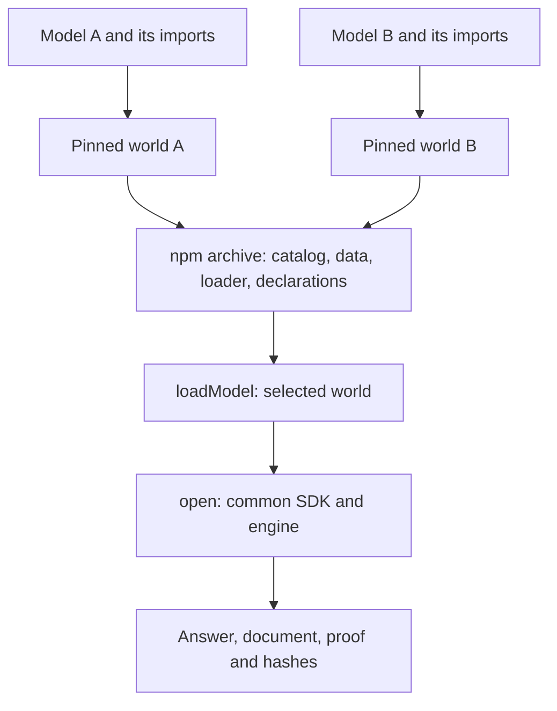

# Shipping a canon with several models

A maintainer's guide to the Node.js delivery pattern used by
`@arxo/canon-fr-benefits@0.1.0`. For application code, start with the
[package API](README.md). The [source pin](source-pin.json),
[loader](src/index.js), [builder](tools/build.mjs) and
[delivery tests](test/README.md) are the working reference implementation.

## The pattern and its present scope

One npm archive can contain several executable models. Each model has an
exact spec and a separately prepared world containing its dependency closure.
A small loader returns the selected world to `@arxo/law`; the common engine
executes its rules and produces the evaluation document and proof.

This is a reusable architecture. The current builder, pin format, subpaths
and error text are specific to this French canon. A generic command accepting
any canon manifest has not yet been extracted. Adapting the example involves
selecting and pinning a new canon's inputs, resources, exports and runtime,
then checking the resulting archive.



Multiple worlds in an archive do not create a combined household calculation.
Interactions between models must be declared in the models and their imports.
A shared dependency can appear in more than one world. Loading one world is
lazy; installing the package still downloads the entire archive.

## Separate the identities

| Identity | What it identifies |
|---|---|
| Model spec, e.g. `fr.apl@0.1.0` | A version of a source model |
| World hash | Exact linked JSON bytes, including the model's imports |
| npm name/version | A delivery of data, loader, declarations and examples |
| SDK version | The runtime tested against that delivery |
| Language semantics | The model data's semantic revision |
| Legal time in a case | The date for which a query is evaluated |

These versions and dates do not move together automatically. A loader update
can require a new npm version without changing the model or its legal dates.
A changed imported package can change a world even when the root model's
own declarations are unchanged; apply the model versioning rules and refresh
all affected pins and evidence explicitly.

In the source registry descriptor, `contentHash` identifies **package CLIR**.
The loader hands a linked world to the facade and therefore sets:

```text
package.meta.contentHash        = worldHash
package.meta.packageContentHash = descriptor.contentHash
```

The original descriptor is returned separately. The world hash, npm tarball
hash and engine program/result/proof hashes identify different objects;
they need not be equal. Check original JSON bytes before parsing them;
re-serializing JSON changes the object whose hash is being checked.

## Choose the public entry points

Choose models around tasks a consumer can perform. Internal dependency
packages do not all need public entry points. For each exported model, keep
an exact spec, a unique subpath and its namespace.

One archive is useful for a group with common ownership, rights, runtime and
release cadence. Separate archives may be more suitable for independent
models, incompatible runtime requirements or a large download that most
consumers would not need.

The current declaration generator keys `CanonRegistry` by model name. It
supports one pinned version of each model name per release. Shipping different
versions of the same name with different relation declarations requires a
separate type/export design.

## Prepare frozen public inputs

This release uses public export commit
`f2efcc6788465484f145146a3ed5f76b13d41703`. Its npm builder does not compile,
migrate or check the live subject corpus. Prepare and review a public source
export before packaging it.

For each entry point, collect its original package CLIR, linked world and
descriptor. Include referenced question catalogs and all separately needed
runtime resources. Freeze origin, revision, paths, byte counts and SHA-256.

A reference to a resource is not evidence that the resource was shipped.
If another canon needs an external calendar, dataset or snapshot, extend the
adapter and declarations, pin the resource and exercise a query that uses it.
The present French loader is not already an adapter for every resource type.
A returned question catalog is metadata; it does not automatically fill
`CaseInput` or create a universal questionnaire.

Keep model/code rights and captured publisher material distinct. Preserve
LICENSE, NOTICE and WITHHELD metadata. Do not restore excluded publisher
files merely to make installation convenient.

## Pin and package layout

The example's source pin uses `arxo.fr-benefits-source-pin/1`, a
provider-specific format, rather than an already standardized general schema.
It records origin and commit, tested runtime, exact model specs, namespaces,
subpaths, world/package/catalog hashes, semantic revision and source files.

The `files` map pins shipped **source assets**. It does not claim to list every
generated JS file, declaration or example. The final archive inventory and
its checksum provide delivery evidence for the whole package.

```text
package.json, source-pin.json    maintained inputs
src/index.js                    maintained common loader
models.json                     generated lightweight catalog
src/<subpath>.js                generated pinned model wrappers
index.d.ts, types/*.d.ts         generated specs and query declarations
data/<subpath>/descriptor.json   original descriptor
data/<subpath>/package.lawir.json original package data
data/<subpath>/world.lawir.json   original linked world
data/resources/<hash>.json      referenced catalogs
examples/                       complete documented case input
LICENSE, NOTICE, WITHHELD.json   pinned rights metadata
```

Generated data, declarations and entry wrappers are ignored in the source
checkout and regenerated for packaging. Never copy another checkout's
`node_modules`, build caches or old binary bundles into a new release.

## Reproduce this example

In a checkout of this repository, from `npm/`:

```sh
node tools/build.mjs --canon ..
npm ci --ignore-scripts
npm test
npm run test:types
```

The builder checks each input's bytes and hash against the immutable pin.
This works only if the adjacent registry still contains the pinned bytes;
the name of a branch such as `main` is not a source identity. A separate
frozen export directory can be passed to `--canon` instead.

Without `--canon`, the builder verifies already prepared local assets and
regenerates catalog, exports and declarations. It does not download missing
inputs. Package CLIR supplies root relation declarations; the linked world
supplies qualified imported relation names.

## Loader contract and consumer code

```js
import { open } from '@arxo/law';
import { loadModel } from '@arxo/canon-fr-benefits/apl';

const model = await loadModel();
const apl = await open(model.spec, {
  offline: true,
  local: { packages: { [model.spec]: model.package } },
});
```

Root `loadModel(exactSpec)` selects a catalog entry. A subpath's `loadModel()`
selects its pinned entry. The returned value contains:
`{ spec, package: { ir, meta }, descriptor, pin, questionCatalog? }`.

Root import reads only metadata and the catalog. Loading checks the selected
descriptor, raw world bytes, model identity/semantics and referenced catalog.
Unknown or versionless specs fail with `ModelNotFoundError`; altered or
unreadable model assets fail with `ModelIntegrityError`. There is no network
fallback. Corruption of the root code/catalog is also a package-delivery
integrity concern, distinct from these model-asset errors.

Installing this aggregator and calling only `open('fr.apl@0.1.0')` is not the
contract. Pass the loaded package through `local.packages`. Older single-canon
packages can use `package-meta.json` and automatic resolution; a `canon-`
name alone does not make those layouts interchangeable.

Each load returns independent parsed data. Reuse an opened `LawPackage` for
multiple cases and keep a bounded set of open models in long-running workers.
The facade used here has no public `dispose()` method; this loader does not
introduce a runtime pool or change the engine lifecycle.

Use explicit case facts, judgments and selected interpretations. Money and
Decimal values are strings. Handle evaluation status and absent values before
reading an amount. Keep `answer.document` as the canonical bytes returned by
the engine rather than rebuilding the document from its projections.

## Compatibility and archive checks

The first release pins `@arxo/law@0.4.2` with engine `0.5.2` and requires
Node.js 20+. Check the claimed minimum version, not only the maintainer's
current Node. Node-only exports do not promise browser compatibility.

Generated declarations check model specs and query names, including qualified
imports. They do not turn the general `CaseInput.answers` array into an
inferred subject questionnaire. The strict consumer fixture uses TypeScript
5.9.3 with `ES2022`, `DOM` and `ESNext.Disposable`; the engine declarations
expose an optional disposal symbol.

Before release, check the following against the candidate archive:

| Check | Purpose |
|---|---|
| Every public catalog entry/export loads | Complete pinned assets and exports |
| Every selected model opens and unfolds | SDK/data compatibility and linked inputs |
| Representative complete cases and resources | Runtime behavior for this canon |
| Unknown spec and corrupted assets refuse | No silent fallback or missed integrity check |
| Separate loads remain independent | No shared mutable IR cache |
| Missing/invalid facts and exact money | No invented defaults or JS arithmetic |
| Explicit readings/judgments, where relevant | A human choice remains an input |
| Canonical document, proof and hashes | Evidence survives the SDK projection |
| Strict installed-package TypeScript | Complete `.d.ts` closure and correct augmentation |
| Minimum Node version | Accurate runtime baseline |
| Archive contents, rights and size | No withheld files, caches or missing resources |

Build and pack from `npm/` into a new candidate directory:

```sh
npm pack --ignore-scripts --pack-destination /path/to/new-candidate
```

Install that tarball in a new consumer project with the tested SDK, rather
than resolving imports to this source checkout. For this example:

```sh
npm install /path/to/new-candidate/arxo-canon-fr-benefits-0.1.0.tgz \
  @arxo/law@0.4.2 typescript@5.9.3
node node_modules/@arxo/canon-fr-benefits/examples/run-apl.mjs
```

The consumer project should have `"type": "module"`. Copy `test/types.fixture.ts`
to that project's root and run its local compiler:

```sh
./node_modules/.bin/tsc --noEmit --strict --target ES2022 \
  --module NodeNext --moduleResolution NodeNext \
  --lib ES2022,DOM,ESNext.Disposable types.fixture.ts
```

Do not hide missing dependency declarations with `skipLibCheck`. That strict
check found a missing exported SDK declaration during the first release;
the fix preserved runtime bytes and changed only the necessary SDK delivery
and dependency pins. A new canon does not routinely require a new SDK release.

## Release and verify delivery

Production npm publication for this project belongs to the delivery CI,
using a committed candidate manifest and hash-checked tarballs. `npm pack`
above prepares an archive; it does not authorize or perform publication.

1. Compare shipped inputs with this package's latest published snapshot.
   Select changed packages and necessary dependent consumers only.
2. Check and record the archive inventory, SHA-256, versions and acceptance
   boundary. Place exact tarballs in immutable release assets and pin their
   location in the candidate manifest.
3. Commit the reviewed manifest and deliver those exact bytes through CI.
   Check dependency/peer order explicitly; the consumer follows the public
   availability of its required dependencies.
4. Wait for registry metadata and ordinary anonymous installation by name.
   A new npm name can return cached 404s after publication; wait for metadata
   propagation before assuming the publication failed or creating another version.
5. Download the public tarball and compare its SHA with the candidate. Verify
   `latest`, the package README, the clean consumer example and strict types.
6. Record delivery evidence and subject acceptance separately.

Do not query a new package name before its first publication attempt, which
can seed negative registry caches. In this project's current delivery recipe,
publish directly under `latest`; check README with `npm view <name> readme`
without a version suffix. Adding a dist-tag alone does not repair a README
missing from the publication record.

Published version bytes are immutable. Inspect registry identity after a
partial failure. Retry identical delivery only after verifying its identity;
changed bytes need a new version and candidate.

The first French release records `releaseVerified: false`, corpus
`not_checked`. Successful packaging, SDK execution and installation do not
establish full subject coverage, legal accuracy or completeness.

## Adapting the pattern

Choose the new canon's entry points and dependency closure; prepare a public
frozen export; pin its identities, resources and rights; adapt exports and
metadata; generate declarations; validate a complete representative case and
the installed archive; register the package in the publisher's explicit
selection; deliver and verify its exact bytes.

A future common builder could accept those choices in a declarative manifest
and reuse the mechanical parts of this implementation. This guide documents
the existing pattern; it does not announce that builder, new resource adapters
or an automatic migration of older canon packages.
